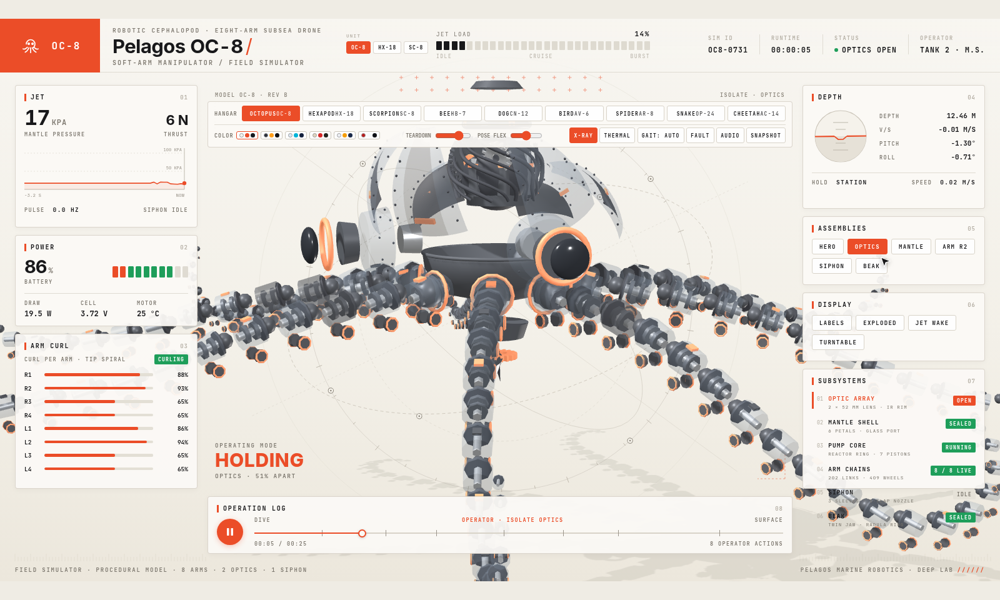

# Pelagos OC-8 & 18-DOF Hexapod — 3D Biomimetic Robotics Teardown Field Simulator

An interactive 3D engineering field simulator and procedural teardown workbench for nine biomimetic robotic systems, built with Flask and Three.js on a 1600×900 studio viewport with both WebGL post-processing and a built-in CPU software-rasterizer fallback.



## Features

- **Nine-Unit Biomimetic Robotics Fleet** (`static/pelagos_sim.js` + `static/pelagos_fleet.js`):
  1. **OC-8 (`Pelagos OC-8`)** — Eight-arm subsea cephalopod manipulator (202 articulated links, 409 suction rollers, mantle jet propulsion, 6-petal shell, 7-piston pump core, optical array, beak/radula).
  2. **HX-18 (`Hexapod HX-18`)** — 18-DOF six-legged arthropod walker (coxa, femur, and tibia servo joints per leg with alternating tripod gait).
  3. **SC-8 (`Telson SC-8`)** — Eight-legged scorpion with 7-segment articulated stinger tail and twin pincer chelae.
  4. **HB-7 (`Mellis HB-7`)** — Four-wing robotic honeybee pollinator with piezo thorax drive and glass abdomen gear train.
  5. **CN-12 (`Canis CN-12`)** — 12-DOF quadruped walker with LiDAR jaw, ribbed thorax, and counter-balance tail.
  6. **AV-6 (`Falco AV-6`)** — Peregrine robotic raptor with 12-feather articulated folding wings and talons.
  7. **AR-8 (`Arachne AR-8`)** — Eight-legged tarantula walker with 8-eye turret, chelicerae fangs, and spinnerets.
  8. **OP-24 (`Ophidia OP-24`)** — 24-joint sidewinder pit-viper snake with 160° hinged fang jaws, rib scutes, and tail rattle.
  9. **AC-14 (`Acinonyx AC-14`)** — High-velocity quadruped with flexing 6-vertebra spine and counter-torque tail.
- **Interactive Teardown & Assembly Isolation**: Continuous teardown slider (`0–100%`) and pose-flex control, plus per-unit sub-assembly isolation (`HERO`, `OPTICS`, `MANTLE`, `ARM R2`, `SIPHON`, `BEAK`, `CHASSIS`, `LEG L2`, `SERVOS`, `CORE`, etc.).
- **Diagnostic View Modes & Engineering Lab Overlays**: X-Ray translucent shell mode, thermal load heatmap overlay, subsystem callout labels, gait/wake traces, fault injection mode, synthesized telemetry audio, 6 livery color arrangements, and PNG snapshot export.
- **25-Second Timeline & Manual Control**: Scrubbable operation timeline with automated dive/gait choreography and instant manual orbit/zoom takeover.
- **WebGL + Built-In CPU Software Renderer**: Uses `THREE.WebGLRenderer` with `EffectComposer` + `UnrealBloomPass` when GPU acceleration is available, and automatically falls back to a built-in canvas 2D software projector/rasterizer when WebGL is disabled.
- **Single-File Offline HTML Exporter**: `GET /api/export/offline.html` bundles HTML, CSS, fonts, Three.js, and simulator scripts into a standalone offline file.

## Requirements

- Python 3.9+ (`Flask>=3.0,<4`)
- Modern browser (WebGL optional; CPU software fallback included)

## Quick Start

```bash
./run.sh
```

Then open `http://127.0.0.1:8104` in your browser. Set `PORT` or `HOST` environment variables to override the defaults (`0.0.0.0:8104`).

## Project Layout

```text
server.py                          Flask server (/api/health, /api/export/offline.html, static serving)
run.sh                             Portable launcher (creates .venv, installs requirements, starts server)
requirements.txt                   Python dependency (Flask)
templates/index.html               8-panel 1600x900 engineering HUD layout
static/pelagos_sim.js              Core 3D engine, OC-8 & HX-18 procedural builders, software rasterizer, HUD
static/pelagos_fleet.js            Additional 7 biomimetic units (SC-8, HB-7, CN-12, AV-6, AR-8, OP-24, AC-14) & lab controls
static/pelagos_sim.css             Studio theme and responsive viewport styling
static/three.min.js                Bundled Three.js r128
static/EffectComposer.js           Three.js post-processing composer
static/RenderPass.js               Three.js render pass
static/ShaderPass.js               Three.js shader pass
static/UnrealBloomPass.js          Three.js Unreal bloom pass
static/CopyShader.js               Three.js copy shader
static/LuminosityHighPassShader.js Three.js high-pass shader
static/fonts/                      Bundled Inter and JetBrains Mono WOFF2 fonts
```

## Model Limits

All nine robotic units are procedural 3D kinematic and visual models authored in JavaScript. Pressures, power draws, temperatures, depths, and fault states shown in the telemetry panels are illustrative engineering curves synchronized to the pose and timeline state rather than finite-element or CFD outputs.

## Licence

MIT; see [LICENSE](LICENSE). Bundled third-party assets remain under their own licences (see [THIRD_PARTY_NOTICES.md](THIRD_PARTY_NOTICES.md)).
